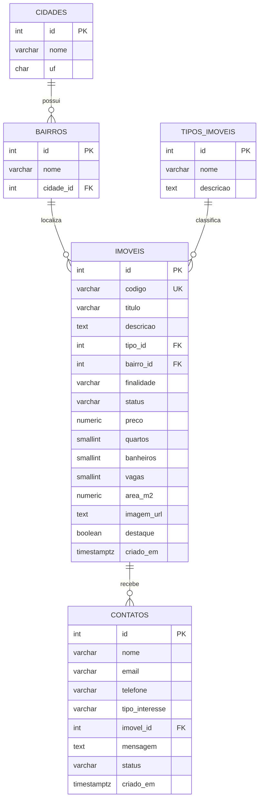

# Modelo de Dados — Casa Viva Imóveis

Documento de banco de dados. Contém o modelo lógico, as
cardinalidades, a justificativa da normalização (3FN) e o código Mermaid
para gerar o diagrama.

---

## 1. Modelo lógico (texto)

> Notação: `atributo` · **PK** = chave primária · *FK* = chave estrangeira.

### CIDADES
| Atributo | Tipo | Restrições |
|---|---|---|
| **id** | INTEGER | **PK**, identity |
| nome | VARCHAR(80) | NOT NULL |
| uf | CHAR(2) | NOT NULL, CHECK `^[A-Z]{2}$` |

Restrição extra: `UNIQUE (nome, uf)` — não existem duas cidades com o mesmo nome no mesmo estado.

### BAIRROS
| Atributo | Tipo | Restrições |
|---|---|---|
| **id** | INTEGER | **PK**, identity |
| nome | VARCHAR(80) | NOT NULL |
| cidade_id | INTEGER | NOT NULL, *FK* → `cidades.id` |

Restrição extra: `UNIQUE (nome, cidade_id)` — o mesmo nome de bairro pode existir em cidades diferentes.

### TIPOS_IMOVEIS
| Atributo | Tipo | Restrições |
|---|---|---|
| **id** | INTEGER | **PK**, identity |
| nome | VARCHAR(40) | NOT NULL, UNIQUE |
| descricao | TEXT | opcional |

### IMOVEIS
| Atributo | Tipo | Restrições |
|---|---|---|
| **id** | INTEGER | **PK**, identity |
| codigo | VARCHAR(12) | NOT NULL, UNIQUE |
| titulo | VARCHAR(140) | NOT NULL, mínimo 5 caracteres |
| descricao | TEXT | NOT NULL, mínimo 20 caracteres |
| tipo_id | INTEGER | NOT NULL, *FK* → `tipos_imoveis.id` |
| bairro_id | INTEGER | NOT NULL, *FK* → `bairros.id` |
| finalidade | VARCHAR(10) | NOT NULL, CHECK `venda` ou `aluguel` |
| status | VARCHAR(12) | NOT NULL, CHECK `disponivel`, `reservado`, `vendido`, `alugado` |
| preco | NUMERIC(12,2) | NOT NULL, CHECK `> 0` |
| quartos | SMALLINT | NOT NULL, CHECK `>= 0` |
| banheiros | SMALLINT | NOT NULL, CHECK `>= 0` |
| vagas | SMALLINT | NOT NULL, CHECK `>= 0` |
| area_m2 | NUMERIC(8,2) | NOT NULL, CHECK `> 0` |
| imagem_url | TEXT | opcional |
| destaque | BOOLEAN | NOT NULL, padrão `FALSE` |
| criado_em | TIMESTAMPTZ | NOT NULL, padrão `NOW()` |

### CONTATOS
| Atributo | Tipo | Restrições |
|---|---|---|
| **id** | INTEGER | **PK**, identity |
| nome | VARCHAR(120) | NOT NULL, mínimo 3 caracteres |
| email | VARCHAR(160) | NOT NULL, CHECK de formato |
| telefone | VARCHAR(20) | NOT NULL, 10 a 13 dígitos |
| tipo_interesse | VARCHAR(10) | NOT NULL, CHECK `comprar`, `alugar` ou `vender` |
| imovel_id | INTEGER | *FK* → `imoveis.id`, **pode ser NULL** |
| mensagem | TEXT | opcional, máximo 2000 caracteres |
| status | VARCHAR(16) | NOT NULL, CHECK `novo`, `em_atendimento`, `atendido` |
| criado_em | TIMESTAMPTZ | NOT NULL, padrão `NOW()` |

---

## 2. Cardinalidades

| Relacionamento | Cardinalidade | Regra de negócio |
|---|---|---|
| CIDADES → BAIRROS | 1 : N (0,N) | Uma cidade possui vários bairros; cada bairro pertence a exatamente uma cidade. |
| BAIRROS → IMOVEIS | 1 : N (0,N) | Um bairro pode ter vários imóveis; cada imóvel está em um único bairro. |
| TIPOS_IMOVEIS → IMOVEIS | 1 : N (0,N) | Um tipo classifica vários imóveis; cada imóvel tem um único tipo. |
| IMOVEIS → CONTATOS | 1 : N (0,N) | Um imóvel pode receber vários contatos; cada contato referencia **no máximo um** imóvel (ou nenhum). |

---

## 3. Diagrama Entidade-Relacionamento (Mermaid)

Copie o bloco abaixo e cole em <https://mermaid.live> para gerar a imagem
que será usada no relatório e nos slides.

---

## 4. Por que o modelo está na 3ª Forma Normal (3FN)?

**1FN — valores atômicos.**
Nenhuma coluna guarda listas. Um imóvel tem um único `tipo_id` e um único
`bairro_id`; se precisasse de vários, existiria uma tabela associativa.

**2FN — sem dependência parcial.**
Todas as tabelas usam chave primária simples (`id`), então não há atributo
dependendo apenas de parte de uma chave composta.

**3FN — sem dependência transitiva.**
- O nome da cidade não fica repetido em `imoveis`; ele fica em `cidades` e é
  alcançado por `imoveis → bairros → cidades`.
- O nome do tipo não fica repetido em cada imóvel; fica em `tipos_imoveis`.
- O nome do bairro não fica repetido em `contatos`; o contato aponta para o
  imóvel e o imóvel aponta para o bairro.

Assim, alterar o nome de uma cidade ou de um tipo é um único `UPDATE`, sem
risco de deixar registros inconsistentes.

---

## 5. Decisões de projeto que valem citar na apresentação

1. **`ON DELETE SET NULL` em `contatos.imovel_id`**: se um imóvel for
   excluído, o histórico de contatos não é perdido.
2. **`ON DELETE RESTRICT` em `imoveis.tipo_id/bairro_id`**: impede excluir um
   tipo ou bairro que ainda tenha imóveis vinculados.
3. **CHECKs no banco além da validação no Flask**: a API valida para dar
   mensagens amigáveis; o banco valida como última linha de defesa.
4. **Índices nas FKs**: o PostgreSQL não cria índice automático para chaves
   estrangeiras; sem eles, os JOINs ficariam mais lentos.
5. **`NUMERIC` para dinheiro**: evita erros de arredondamento do tipo
   `float`, comuns em valores monetários.
